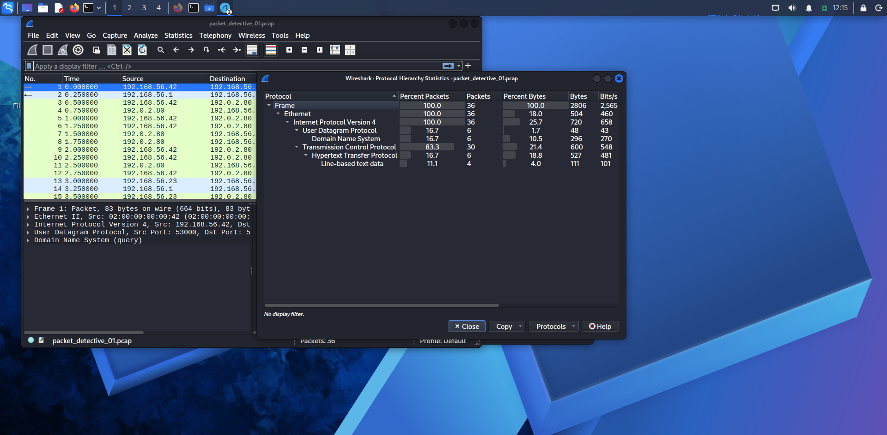
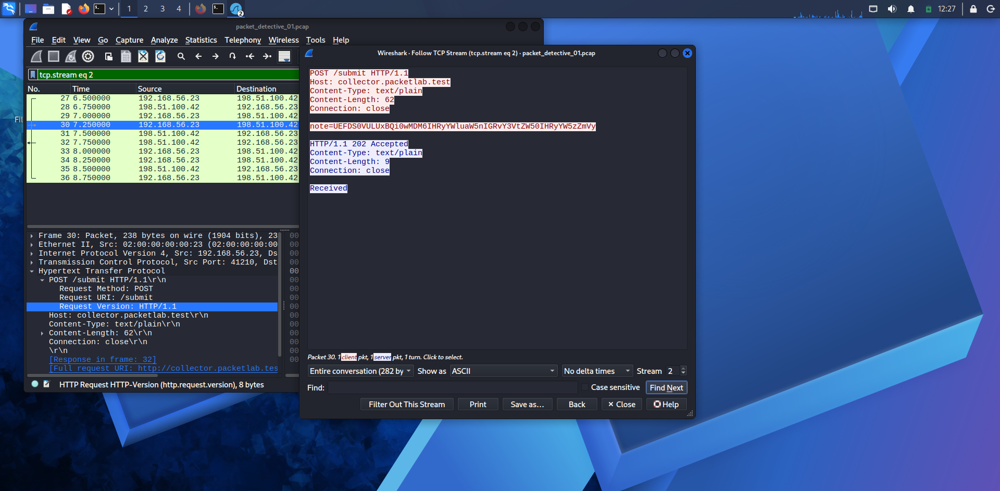
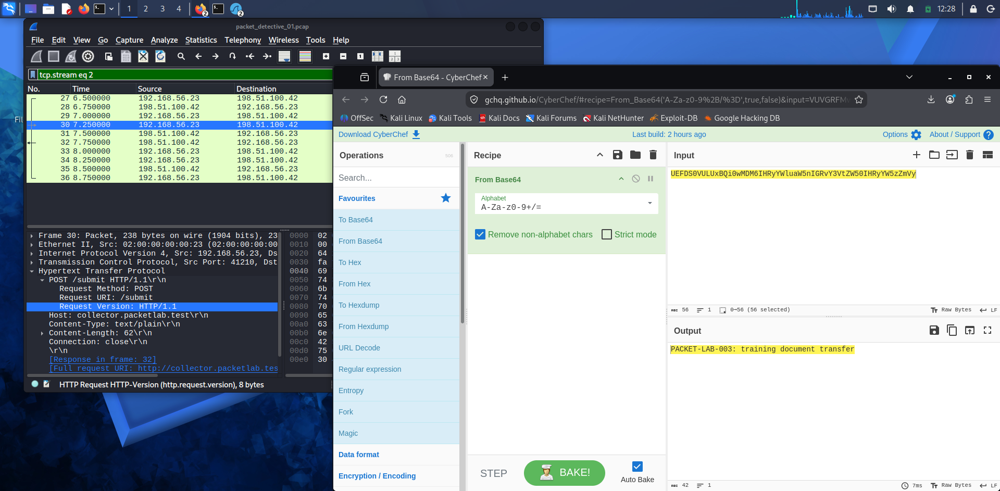
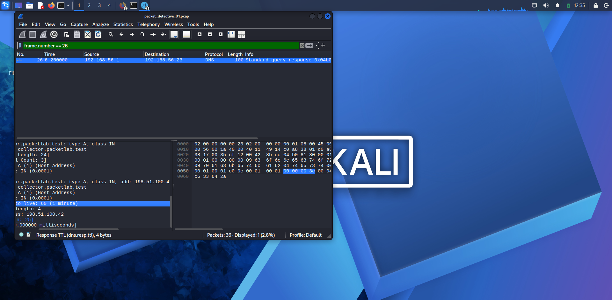

# Packet Detective 01 | PCAP Traffic Analysis

**Siber Vatan 2027 • 3. hafta • 25 Kasım 2026**

Linux, ağ temelleri, Wireshark ve kodlama konularını birleştirdiğim ilk uygulamalı ağ analizi çalışmam. Amaç, sentetik bir PCAP kaydında veri aktarımını tespit etmek, kanıtları ilişkilendirmek ve SOC analisti yaklaşımıyla değerlendirmekti.

> Eğitim amaçlı kişisel portföy çalışmasıdır; resmî Siber Vatan projesi veya gerçek bir güvenlik olayı değildir. Trafik, yapay zekâ desteğiyle oluşturulmuş sentetik veridir. Analiz adımlarını Kali üzerinde uyguladım; bazı adımlarda ChatGPT'den ipucu ve yönlendirme aldım. Raporun düzenlenmesinde de ChatGPT kullanıldı.

## Kısa sonuç

| Ölçüm | Sonuç |
|---|---|
| Toplam paket | 36 |
| IPv4 uç noktası | 5 |
| TCP / UDP | 30 / 6 |
| DNS / HTTP | 6 / 6 (üst katmanlar) |
| HTTP istekleri | 2 GET, 1 POST |
| İncelenen paket | 30 — POST /submit |
| DNS yanıtı | 26 — collector.packetlab.test → 198.51.100.42 |
| Sunucu yanıtı | 32 — HTTP 202 Accepted |
| Karar | Investigate — ek inceleme gerekli |

## Analiz akışı

1. **Bütünlük:** `sha256sum -c packet_detective_01.sha256` → OK.
2. **Trafik keşfi:** Protocol Hierarchy ve Endpoints ile protokoller ve IPv4 adresleri.
3. **HTTP analizi:** `http.request` ve `http.request.method == "POST"` filtreleri.
4. **Oturum incelemesi:** Follow TCP Stream ile gönderilen metin ve sunucu yanıtı.
5. **Kod çözümü:** CyberChef, From Base64 → `PACKET-LAB-003: training document transfer`.
6. **DNS korelasyonu:** `dns` ve `frame.number == 26` filtreleriyle hedef alan adı ve IP ilişkisi.
7. **SOC kararı:** Aktarımın yetkili olup olmadığına dair yeterli kanıt bulunmadığından ek inceleme.

## Seçili kanıtlar

**Protokol dağılımı**



**HTTP oturumu**



**Base64 çözümü**



**DNS korelasyonu**



## Dosyalar ve yeniden inceleme

- [Ayrıntılı teknik rapor](analysis_report.md)
- [PCAP](packet_detective_01.pcap) ve [SHA-256](packet_detective_01.sha256)
- [Kanıt ekran görüntüleri](screenshots/)

PCAP ve SHA-256 dosyalarını aynı dizine indirip şu komutları çalıştırabilirsiniz:

```bash
sha256sum -c packet_detective_01.sha256
wireshark packet_detective_01.pcap
```

Bu kayıt çevrim dışı analiz içindir. IP adresleri eğitim ve dokümantasyon amaçlıdır; herhangi bir hedefe bağlantı kurmak gerekmez.

**English summary:** A guided beginner SOC portfolio exercise covering offline PCAP analysis, SHA-256 integrity verification, HTTP/DNS correlation and Base64 decoding. The evidence supports further investigation, not a confirmed compromise or exfiltration.
